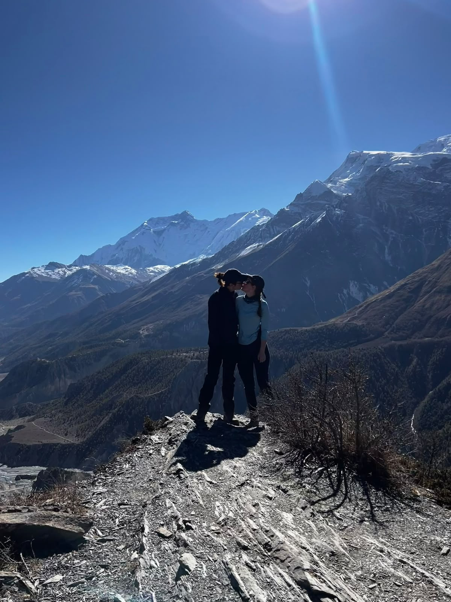
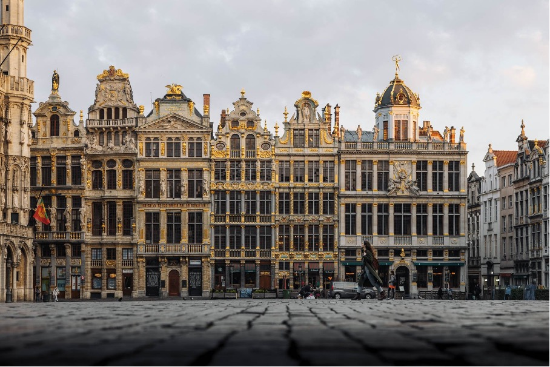

We're incredibly happy to be sharing this day with you.

## When

Saturday the **8th of May 2027**

### Program of the day
To be revealed closer to time 

##  Where

The address of the day:
> Chateau-Ferme de Profondval 
> Chemin de Profondval, 2  
1490 Court-Saint-Etienne 
Belgium

(Post codes in Belgium are NOT precise at all, you need the whole address)

<iframe src="https://www.openstreetmap.org/export/embed?bbox=4.144592285156251%2C50.366488762738264%2C5.078430175781251%2C50.941123218673084&amp;layer=mapnik&amp;marker=50.65468471250644%2C4.61151123046875" style="border: 1px solid black; width: 100%; max-width: 100%;"></iframe> 

[View on Google Map](https://maps.app.goo.gl/GKhirPko3nwdws6BA) 

### ⚠️ Note the wedding is near *Louvain-la-Neuve*, which is NOT  *Louvain/Leuven* 

## Getting to Belgium
* [Eurostar](https://www.eurostar.com/) from London to Brussels. Book well in advance for a good deal.
* Nearby airports:
	* [Brussels Airport (Zaventem)](https://www.brusselsairport.be/en/)
	* [Brussels South Charleroi Airport](https://www.brussels-south-charleroi-airport.com/en/) (not in Brussels, harder to get to the location)

## Getting to the venue

### Trains
[Trains](https://www.belgiantrain.be/en) are cheaper and more reliable than in the UK. No need to book in advance, but you do need to buy a ticket before getting on board. The trains stop running quite early, around 10-11 PM.

Allow 15 minutes for transfers in Ottignies due to upgrade works.

From the Louvain-La-Neuve train station to the Chateau is a 35 minute walk.
If you're taking a taxi, the Ottignies station might be easier to get a taxi.

## Buses
There are some [buses](https://www.letec.be/en) in the area, but not very frequent.

#### Taxi companies
* [Taxi Broeck](https://taxi-ottignies-lln.be/) - [+32 471 43 84 99](tel:+32471438499)
* [Uber](https://www.uber.com/global/en/) operates in the area

## Hotels
* [Martin's](https://www.martinshotels.com/en/page/martins-louvain-la-neuve/martins-louvain-la-neuve-innovation-lifestyle-hotel.11057.html) and [Piano 2](https://www.piano2.be/)  come recommended from friends
* [ibis Styles](https://all.accor.com/hotel/2200/index.fr.shtml) 
* [Gite Mozaik](https://www.gite-mozaik.be/en/) a little cheaper

## Local attractions

Louvain-la-Neuve is a student town, expect loud students who have drunk a bit too much.

* [Walibi](https://www.walibi.be/en) amusement park 
* [Waterloo battlefield](https://waterloo1815.be/en)
* [Brussels](https://visit.brussels/en) is a short train ride away

* [Namur](https://www.namurtourisme.be/en/) is a medieval city with a lovely citadel
* [Villers Abbey](https://www.villers.be/en) to visit an old ruin, or skip ahead and go straight to the beer
### Further afield
* [Leuven](https://www.visitleuven.be/en), [Brugge](https://www.visitbruges.be/en) and [Gent](https://visit.gent.be/en) are a train ride away and well worth the trip

## Food
A small selection of what's in the area, many more are available.
### Restaurants
* [Le Brasse Temps](https://maps.app.goo.gl/VrMQs5SiKaSQ6GUZ6) brewery is an Eilish favourite
* [Café des Halles](https://maps.app.goo.gl/C3DoWbfeGrPtowKB7) bar and restaurant (worth a booking for groups)
* [La Branche de Figuier](https://maps.app.goo.gl/UvaWg5JzzTwdBSXW7) Palestinian restaurant
* [Chez Jean-Lou](https://maps.app.goo.gl/h8RV1x2tnZYk11Rw6) - typical Friterie serving burgers and chips in the middle of a car park

### Bars
* [Le Beer Bar](https://maps.app.goo.gl/MXLGw661zGM9yhQh7): 16 kegs of the best Belgian beers
* [Fox](https://maps.app.goo.gl/j2Cwobv6oVXQeh2i9)
### Snacks
[Gofidor waffles](https://maps.app.goo.gl/85Qoye1uXHAPuRoeA) is a classic.